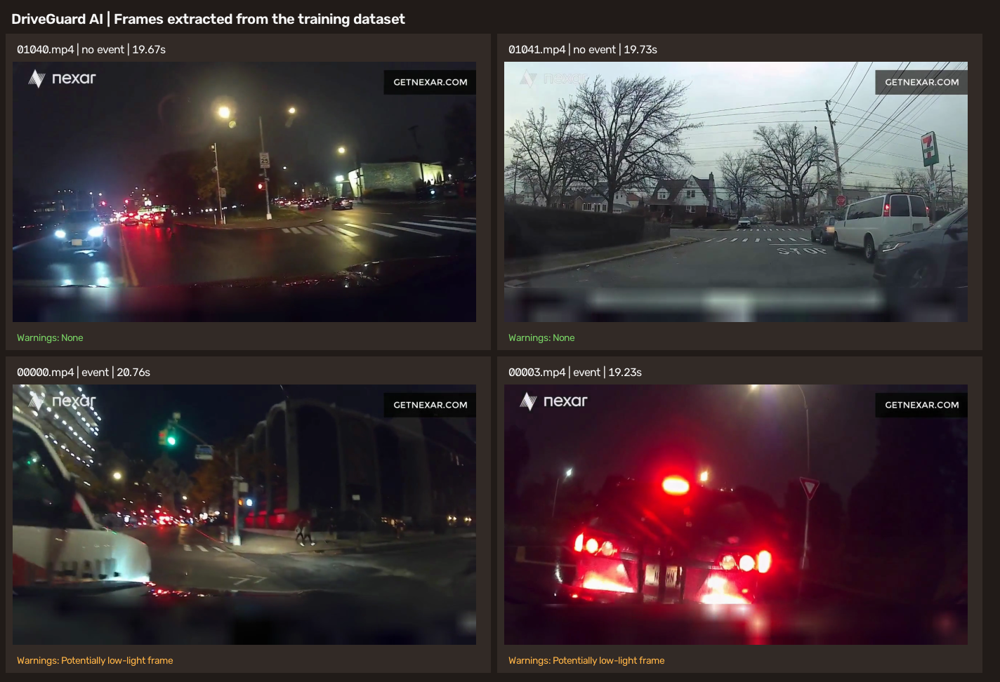

# DriveGuard AI

**Road-video detection, tracking, and experimental edge-case monitoring.**

DriveGuard AI uses pretrained YOLOv8 and ByteTrack to annotate road videos.
Open the Streamlit dashboard to upload a video, view the annotated result, and
review heuristic alerts.

> This is an educational prototype, not a certified driver-assistance
> system. Risk levels and image-quality warnings are heuristics, not safety
> predictions. Do not use them to make driving decisions.

## Overall project review

**Assessment: a useful, working computer-vision prototype—not a validated
detection or collision-prediction system.**

**What works:** The project connects pretrained YOLOv8 detection, ByteTrack
tracking, video annotation, a Streamlit review interface, and CSV event
exports. It checks frames for possible low light or blur and flags sudden drops
in YOLO detection counts. Automated tests cover core logic and a short
video-processing path.

**What the results establish:** The four displayed dataset frames are real
frames with reproducible brightness and blur measurements. Two trigger the
low-light rule. The dataset has video-level event labels, not frame-level
quality labels or bounding-box ground truth, so these examples cannot establish
warning or object-detection accuracy. The separate timestamp-presence baseline
uses label metadata, not video pixels; its metrics are not model performance.

**Main gaps:** Risk scores use image-space motion and uncalibrated rules; they
do not represent physical distance, reliable time-to-collision, or collision
probability. Four sample frames are illustrative, not enough to evaluate
general performance. A detection-count drop is a review cue, not proof that an
object was missed.

**Recommended next steps:** Add frame-level object and image-quality
annotations, build a larger representative sample, and evaluate on held-out
videos. Report task-appropriate metrics (for example, detector precision/recall
and warning false alarms/misses), then calibrate the thresholds. Keep the
safety disclaimer until those evaluations are complete.

## Quick start

Run these commands from the project root:

```bash
python3 -m venv venv
source venv/bin/activate        # Windows: venv\Scripts\activate
python -m pip install -r requirements.txt
python -m streamlit run app/dashboard.py
```

Open the local URL printed by Streamlit. Upload an MP4, choose a YOLO model and
confidence threshold, then select **Analyze video**.

## What the app shows

- Original uploaded video and annotated output video.
- Detected objects, track IDs, and heuristic risk levels.
- Orange **EDGE CASE** overlays for low-light, blurry, or sudden detection-count
  drop warnings.
- Risk-event and edge-case CSV files in `outputs/annotated_videos/`.
- Real training-dataset frame samples and their measured quality warnings.

## Dataset frame evidence

The sample evidence uses **original frames decoded from the local training
videos**, not generated or altered example images. The contact sheet below
shows the source video, video-level label, timestamp, and the monitor warning.



The current four-frame sample contains two event videos and two no-event
videos. The monitor flags two frames as **Potentially low-light frame**; it
flags none as blurry. For example:

| Video | Label | Frame / time | Brightness | Blur score | Warning |
|---|---|---:|---:|---:|---|
| `00000.mp4` | Event | 600 / 20.761 s | 42.37 | 226.41 | Potentially low-light frame |
| `00003.mp4` | Event | 577 / 19.233 s | 42.17 | 149.78 | Potentially low-light frame |
| `01040.mp4` | No event | 590 / 19.667 s | 48.93 | 355.78 | None |
| `01041.mp4` | No event | 592 / 19.733 s | 114.01 | 1908.47 | None |

**These results are not an accuracy score.** The dataset labels whole videos
for events; it does not provide frame-level labels for brightness, blur, or
object-detection boxes. The warning counts describe only these four samples.

### Regenerate the samples

With `data/train.csv` and the corresponding videos under `data/train/`, run:

```bash
python -m src.edge_case_samples
```

By default, this selects two videos from each target class. Positive samples
use the dataset `time_of_event`; negative samples use the video midpoint.
Files are written to `results/edge_case_dataset/`:

- `frames/` — extracted PNG frames.
- `edge_case_dataset_contact_sheet.png` — visual sample summary.
- `sample_results.csv` — frame measurements and warnings.
- `summary.json` — sample and warning counts.

## Run video processing from the terminal

```bash
python src/detect_video.py \
  --video data/train/00000.mp4 \
  --model yolov8n.pt \
  --output-dir outputs/annotated_videos \
  --max-frames 100
```

Remove `--max-frames 100` to process the full video. Available options:
`--video` (required), `--model`, `--output-dir`, `--conf`, `--max-frames`, and
`--display`. The first run may download YOLO weights.

## Edge-case warning rules

| Alert | Trigger |
|---|---|
| Potentially low-light frame | Mean grayscale brightness below 45 |
| Potentially blurry frame | Laplacian variance below 50 |
| Sudden detection-count drop | Previous count at least 3 and current count less than half of it |

Thresholds are initial heuristics and need calibration on representative,
frame-labeled data. A warning signals a condition to review; it does not prove
an object was missed or a collision will occur.

## Tests

```bash
python -m pytest tests -q
```

The tests cover dataset-frame extraction, edge-case warning rules, risk-engine
behavior, metrics, and video processing. Passing tests verifies the tested
software behavior only; it does not establish real-world detection accuracy
or safety.

## Project structure and file guide

```text
DriveGuardAI/
├── app/
│   └── dashboard.py
├── data/                         # Local dataset files (not committed)
│   ├── train.csv, test.csv
│   ├── train/<video_id>.mp4
│   └── test/<video_id>.mp4
├── results/
│   └── edge_case_dataset/        # Extracted sample frames and reports
├── outputs/
│   └── annotated_videos/         # Processed videos and event CSVs
├── src/
│   ├── analyze_labels.py
│   ├── detect_video.py
│   ├── edge_case_monitor.py
│   ├── edge_case_samples.py
│   ├── edge_case_summary.py
│   ├── evaluate_collision.py
│   ├── inspect_dataset.py
│   ├── risk_engine.py
│   └── train_detector.py
├── tests/
├── requirements.txt
├── yolov8n.pt / yolov8s.pt       # Pretrained model weights, if present
└── README.md
```

### Application and processing

| File | What it does |
|---|---|
| `app/dashboard.py` | Streamlit UI for uploading videos, launching analysis, viewing annotated output, reviewing alerts, and showing dataset-frame evidence. |
| `src/detect_video.py` | Reads video frames, runs YOLO and ByteTrack, applies risk and edge-case checks, annotates frames, and writes video plus event CSVs. |
| `src/risk_engine.py` | Maintains per-track history and calculates experimental image-space risk scores and explanatory warnings. |
| `src/edge_case_monitor.py` | Measures frame brightness and blur; checks whether the YOLO detection count suddenly drops. |
| `src/edge_case_samples.py` | Extracts original frames from labeled training videos and writes the contact sheet, CSV, and summary shown in the dashboard. |
| `src/edge_case_summary.py` | Groups consecutive low-light frame events into episodes for reporting. |

### Dataset utilities

| File | What it does |
|---|---|
| `src/inspect_dataset.py` | Checks CSV/video ID matching, video readability, metadata, and dataset structure; writes JSON and text reports. |
| `src/analyze_labels.py` | Summarizes training labels and checks event/alert timestamp fields. |
| `src/evaluate_collision.py` | Calculates a timestamp-presence metadata baseline. This is a label sanity check, not a video model evaluation. |
| `src/train_detector.py` | Writes a future training-plan scaffold; it does not train a detector or classifier. |

### Tests and generated files

| Path | What it contains |
|---|---|
| `tests/test_detect_video.py` | Short video-pipeline integration test. |
| `tests/test_edge_cases.py` | Frame-quality thresholds, detection-count warnings, and extraction fidelity for dataset frames. |
| `tests/test_risk_engine.py` | Risk-level, motion, and TTC-like heuristic behavior checks. |
| `tests/test_dataset.py` | Dataset-inspection behavior and report output tests. |
| `tests/test_collision_evaluation.py` | Metadata-baseline metric calculations. |
| `results/edge_case_dataset/` | Extracted PNGs, contact sheet, sample CSV, and summary JSON; regenerate with `python -m src.edge_case_samples`. |
| `outputs/annotated_videos/` | Generated annotated MP4s and risk/edge-case event CSVs. |
| `requirements.txt` | Python package dependencies. |
| `.gitignore` | Excludes local datasets, generated outputs, virtual environments, and model artifacts. |

The detector uses pretrained weights. The project does not train a custom
detector or collision-prediction model, and it does not estimate calibrated
real-world distances or collision probabilities.
